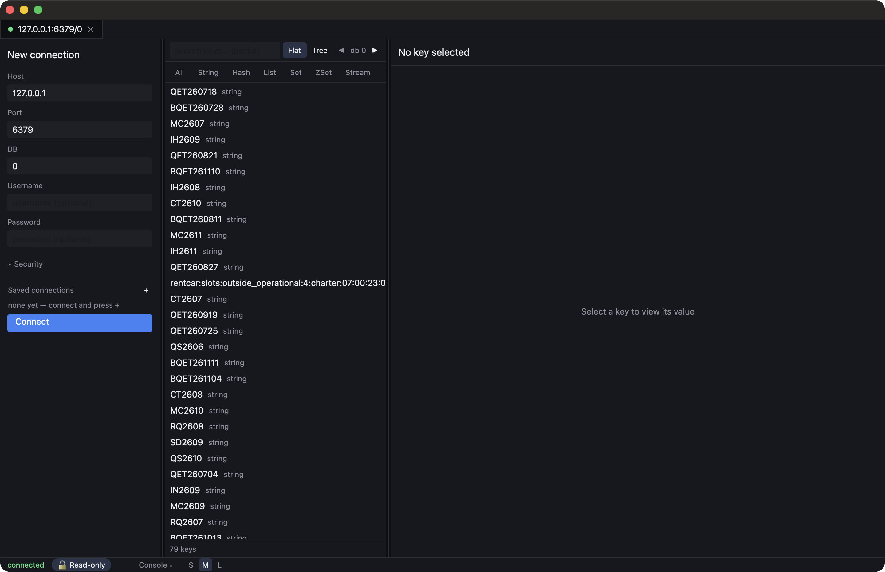
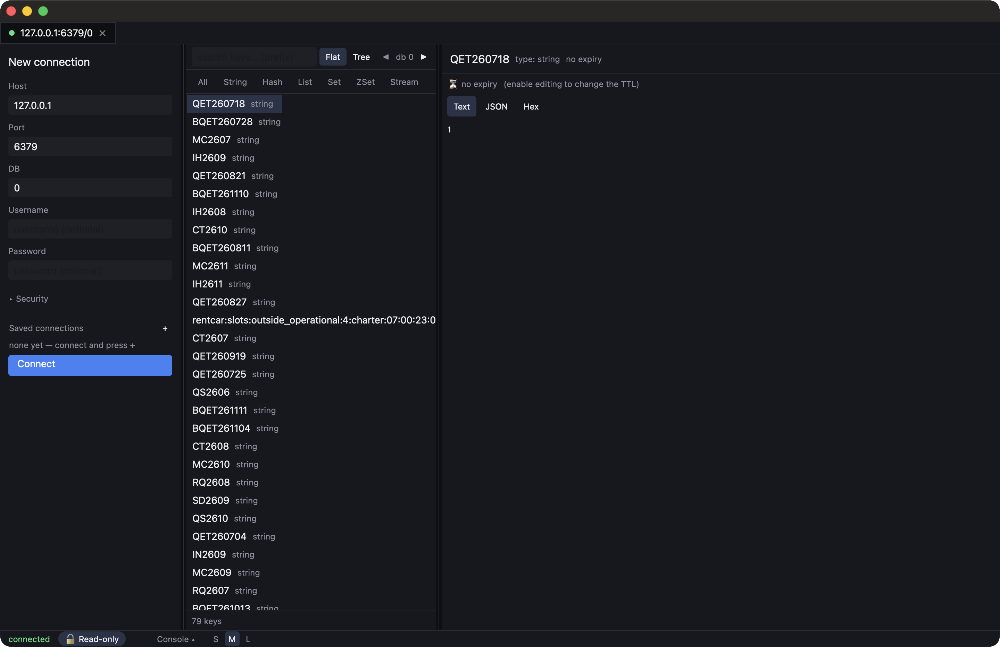
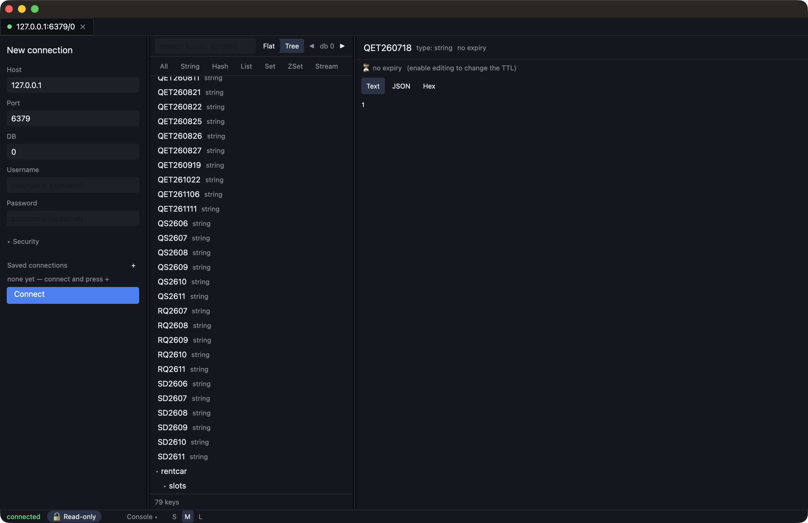
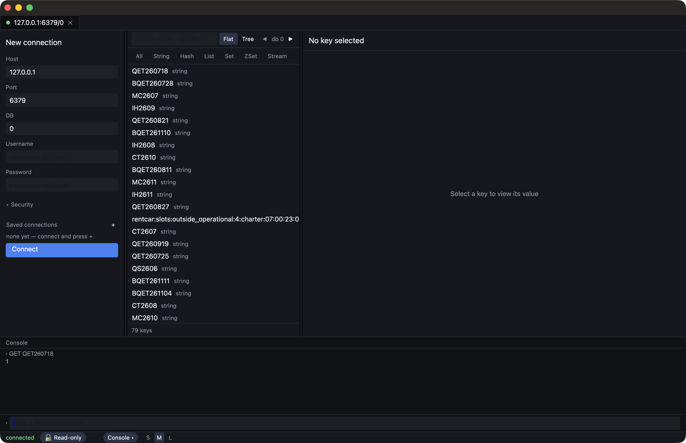

# Redis GPUI

A privacy-first, write-safe Redis GUI desktop app written in Rust, built on [GPUI](https://github.com/zed-industries/zed/tree/main/crates/gpui), the GPU-accelerated UI framework from Zed.

[](https://github.com/bangadam/redis-gpui/actions/workflows/ci.yml)
[](LICENSE)
[](rust-toolchain.toml)



## Why Redis GPUI

Three principles shape the product:

- **Private by default.** No accounts, no cloud sync, no telemetry. Credentials live in the OS keychain, or are prompted per session and never written. Logs never contain passwords, key data, or command results.
- **Native.** A Rust desktop app built directly on GPUI, with keyboard-first navigation, visible focus rings, and list cursor movement.
- **Write-safe.** A Redis client should not be able to damage data by accident. Read-only is the starting state, writes require explicit intent, and uncertain outcomes are surfaced instead of retried.

## Features

| Area | What it does |
| --- | --- |
| Connect | Standalone Redis; ACL username and password; TLS with verify-full as the default, custom CA bundles, client certificates, and an explicit insecure override that keeps a warning chip visible; SSH tunnel, single hop, with TOFU host-key verification. |
| Browse | Batched `SCAN` with pagination; colon-hierarchy tree and flat views; type filter; database switcher; progressive, cancellable search with honest counts ("N so far", never a fabricated total). |
| Inspect | string, hash, list, set, zset, stream, and JSON values, shown byte-faithfully. Text, JSON, and hex are views over the same bytes, not conversions. Unsupported types render visibly read-only. |
| Edit | Read-only by default; editing is opt-in per connection and resets on disconnect or restart; explicit Save only; discard warnings; conflict detection where Redis supports it; TTL create, update, and remove; tri-state write outcomes. |
| Console | Read-only mode runs recognized read commands only (unknown commands and the EVAL family are blocked). Write mode still confirms destructive commands. History is memory-only. |
| Connections | Saved connections keep non-secret metadata on disk and secrets in the OS keychain. Without a keychain, the app prompts per session and writes nothing. |

## Safety model

Write safety is the core of the app, not a preference:

1. **Read-only by default.** Every connection starts read-only. Editing is enabled per connection by an explicit action and is reset on disconnect or app restart.
2. **Explicit saves.** There is no auto-save. A dirty editor warns before a key, tab, or database switch would discard work.
3. **Conflict detection where Redis can provide it.** String saves use `WATCH`/`MULTI` compare-and-swap. If the server value changed since it was read, a modal offers the current value, an overwrite, or cancel. Container types cannot be compared atomically as a whole, so the UI discloses that those saves are last-writer-wins.
4. **No blind retries.** A write ends as acknowledged, definitively failed, or outcome unknown. A lost acknowledgment is shown as "outcome unknown" and is never retried automatically.
5. **Confirmations happen before the network.** Destructive console commands confirm in the client before any bytes are sent. Read-only mode refuses unknown commands and the EVAL family client-side.
6. **Secrets stay out of app files and logs.** Passwords and passphrases go to the OS keychain or a per-session prompt. Saved metadata contains non-secret fields and file paths only.

## Screenshots

### Value views



A string value with Text, JSON, and Hex views over the same bytes; editing stays disabled while the session is read-only.

### Tree view



Tree mode groups colon-delimited key names into an expandable hierarchy.

### Console



Read-only console after a `GET`. Write and script commands are refused client-side until editing is enabled.

## Requirements

- Rust 1.98.1, pinned in `rust-toolchain.toml` (the GPUI revision requires it).
- A reachable Redis server. For local development:

  ```sh
  redis-server --port 6379
  ```

- Network access on the first build: GPUI is pinned to a Zed git revision in `src/Cargo.toml`, so Cargo clones and compiles a large dependency graph.

## Build and run

```sh
cargo run
```

Quality checks:

```sh
cargo fmt --all
cargo clippy --workspace --all-targets
cargo test --workspace
```

Opt-in scale measurement (requires Docker; the harness self-reports a skip otherwise):

```sh
REDIS_GPUI_SCALE=1 cargo test --test scale_measurements -p app-workflows -- --nocapture
```

## Architecture

The repository is one Cargo workspace. GPUI is confined to the app crate, so the safety, browsing, and value logic can be tested headlessly.

| Crate | Responsibility |
| --- | --- |
| `src/` (`redis-gpui`) | Entry point, window boot, and all GPUI views. The only crate that depends on GPUI. |
| `crates/write-safety` | Command policy table, read-only gate, confirmation classification. |
| `crates/redis-io` | Connections, TLS, SSH tunnel, tri-state write outcomes. |
| `crates/browse` | SCAN batching, cancellable search, tree and flat key models. |
| `crates/console-engine` | Console pipeline: parse, policy decision, output. |
| `crates/value-model` | Byte-preserving values, views, dirty editors, TTL. |
| `crates/connections-store` | Non-secret connection metadata, keyring credentials, TOFU known hosts. |
| `crates/theme` | Light and dark token tables, appearance mapping. |
| `crates/app-workflows` | Test-only: boundary workflow tests and the opt-in scale harness. |

## Documentation

- [Keyboard reference](docs/KEYS.md): every shortcut and focus behavior implemented today.
- [Smoke checklist](docs/SMOKE.md): per-OS manual verification, with every row defaulting to unverified.
- [Accessibility report](docs/ACCESSIBILITY.md): what AccessKit provides at the pinned GPUI revision, what is implemented, and what is not.

## Status and verification

Redis GPUI is pre-1.0. The workspace has an automated test suite, and CI is configured to run formatting, clippy with warnings denied, and the workspace tests on macOS.

- **Verified on macOS (Apple Silicon):** a first live run on 2026-11-14 against a local Redis 7 covered plaintext connect, key list with type badges, key selection and value views, the flat/tree toggle and tree expansion, read-only console command execution, and keyboard list navigation.
- **Unverified:** Linux and Windows builds. CI does not run on those platforms yet.
- **Unverified:** every other flow, including TLS, SSH, keyring, and editing against a live server. [docs/SMOKE.md](docs/SMOKE.md) records each flow per OS and defaults every row to unverified.
- **Accessibility:** AccessKit roles and labels are not implemented, so screen-reader support is not claimed. [docs/ACCESSIBILITY.md](docs/ACCESSIBILITY.md) records the current state and the concrete adoption steps.
- **Packaging:** `dist-workspace.toml` and `packaging/` contain configuration and scripts, but no packages have been built or published.

## Contributing

Issues and pull requests are welcome; there is no CLA. Before opening a pull request, run `cargo fmt --all`, `cargo clippy --workspace --all-targets`, and `cargo test --workspace`. Changes that touch the write-safety model (read-only gate, command policy, confirmations, tri-state outcomes) should preserve its invariants and include tests.

## License

MIT. See [LICENSE](LICENSE).
